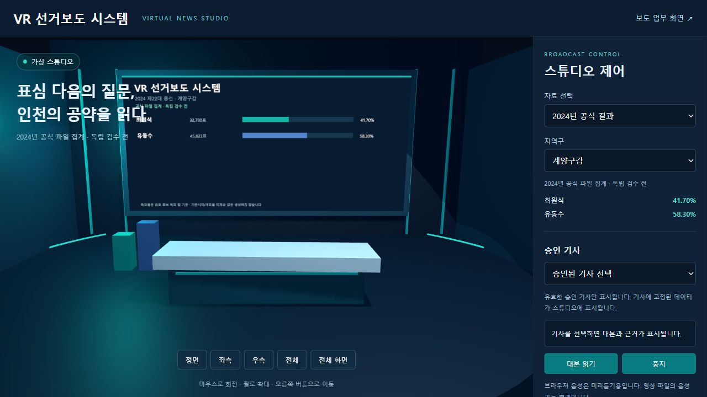
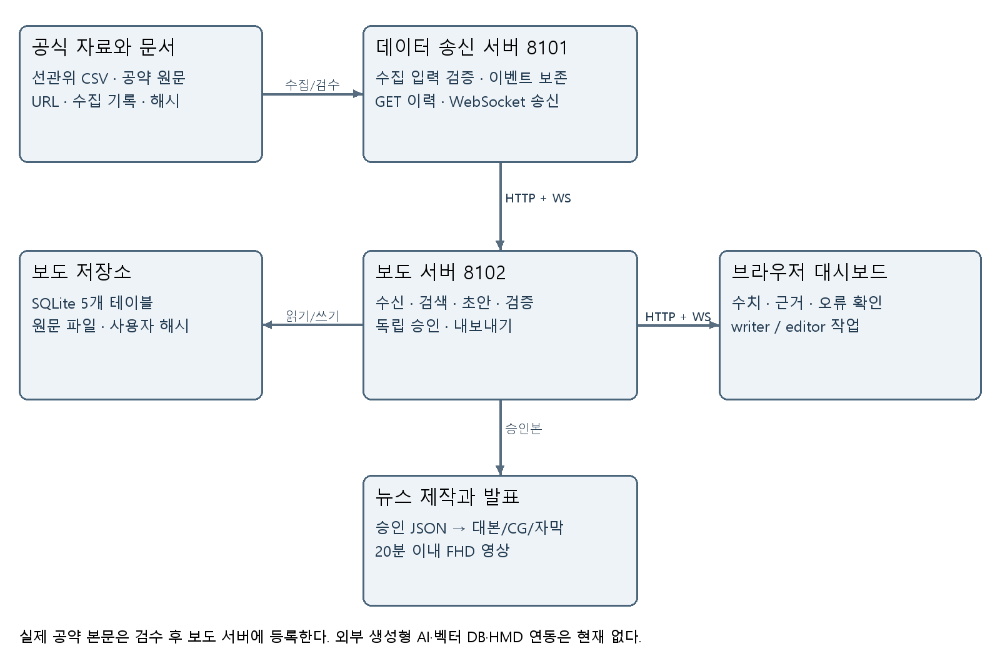

# VR 선거보도 시스템

**표심 다음의 질문, 인천의 공약을 읽다**

## 최신 시스템 실행 화면 연결

현재 이 PC에서 실행 중인 최신 시스템은 아래 링크로 열 수 있습니다.

- [PC 가상 스튜디오 열기](http://127.0.0.1:8202/studio)
- [선거보도 업무 화면 열기](http://127.0.0.1:8202/)

위 링크는 시스템을 실행한 PC에서 서버가 켜져 있을 때 사용할 수 있는 로컬 주소입니다. 현재 실행 포트는 8202이며, 아래 기본 실행 스크립트의 보도 서버 포트는 8102입니다.

## v2 PC 가상 스튜디오와 통합 보도 업무

PC에서 조작하는 **실제 3D 가상 스튜디오**와 자료 검수부터 FHD 제작까지의 업무 화면을 제공합니다. 3D 엔진은 프로젝트에 포함되어 실행 중 CDN 연결이 필요하지 않습니다.



| 기능 | 실제 동작 |
| --- | --- |
| PC 3D 스튜디오 | 마우스 회전·확대, 정면/좌우/전체 카메라, 지역별 결과, 승인 대본, 브라우저 읽기, PNG 캡처 |
| 공식 결과 모드 | 인천 14개 지역구·38명 후보의 원본 해시·원본 행별 후보·득표수·누락 여부 확인, 미제공 시각·개표율 보존, 독립 검수 상태 |
| 문서 등록 | 공식 URL·게시일·후보·권리·본문, 텍스트 PDF 추출과 원본 보존, 청크·근거 ID |
| 독립 검수 | 등록자와 다른 editor의 자료·공약 검수, 반려·철회, 실제 기사 승인 차단 |
| 기사 업무 | 근거 기반 정형 초안, 새 수정 버전, 수치/출처 검증, 독립 승인, JSON 내보내기 |
| FHD 제작 | 승인 기사 선택 → 실제 MP4·SRT·대본·CG·제작 원장·ZIP, 최대 20분 |
| 음성 | 제공한 PCM WAV 결합. 직접 녹음/AI 합성 여부를 표시하며, 없으면 무음으로 명시 |
| 보존 | SQLite 7개 테이블, 감사 해시 점검, DB·원문 백업, 재시작 시 중단 제작 작업 실패 처리 |

처음 실행은 PowerShell에서 `./setup.ps1`입니다. 설치 후 재실행은 `./start.ps1`입니다. 업무 화면은 **http://127.0.0.1:8102**, 가상 스튜디오는 **http://127.0.0.1:8102/studio**입니다. [운영 안내](docs/platform-guide.md)에 역할별 절차, Docker 설정, 제작·복구 방법을 정리했습니다.

공식 결과는 불러왔지만 **사람의 독립 대조를 완료한 것으로 표시하지 않습니다**. 실제 후보 공약 본문을 등록하고 자료·문서 검수와 기사 승인을 거쳐야 실제 자료의 제작물을 내보낼 수 있습니다. 사람의 승인과 가상 TEST 계정의 시험은 구분합니다. 외부 생성형 AI와 HMD 장비 연동은 이 PC 버전에 포함하지 않습니다.

2024년 제22대 국회의원선거 인천 지역구를 대상으로 공식 개표 데이터와 공약 근거를 연결하고, 기사 초안 → 팩트체크 → 독립 편집 승인 → 뉴스 제작으로 이어지는 선거보도 시스템입니다.

이 저장소는 기획·설계 문서 7종, 실제 실행 소스코드, DB SQL 스크립트와 검증·형상관리 기록을 함께 제공합니다. 2026년 11월 24일에 기존 [Real-time-Election-News](https://github.com/mbc-incheon/Real-time-Election-News)의 로컬 후속 수정본을 통합했습니다. 기존 작업 폴더의 미커밋 수정은 보존했습니다.

사용자 지정에 따라 검증된 [election-analysis-project-01의 통합본 00ac79d](https://github.com/mbc-incheon/election-analysis-project-01/commit/00ac79dc6ec77d6bd4c1e883e152fd78f2e3ab91)를 **VR-Election-News**에 직접 커밋했습니다. 현재 저장소의 [변경 기록](https://github.com/mbc-incheon/VR-Election-News/commits/main/)과 [자동 시험](https://github.com/mbc-incheon/VR-Election-News/actions)을 확인할 수 있습니다.

## 구현 결과물과 실행

| 산출물 | 위치 | 제공 내용 |
| --- | --- | --- |
| 데이터 송신 서버 | [election-data-server](election-data-server) | 공식 입력 검사·원본/원장·이벤트 이력·WebSocket 송신 |
| 보도 서버와 화면 | [election-news-server](election-news-server) | 대시보드·근거 검색·초안·검증·독립 승인·JSON 내보내기 |
| DB 스크립트 | [db](db/README.md) | CREATE TABLE·INSERT·무결성/조회 SQL·초기화 도구 |
| 검증 결과 | [구현 결과서](docs/implementation-results.md) | 단위/API/영상 49개·서버 통합 13개·전체 제작 통합 24개·화면 로직 7개 |
| 형상관리와 협업 | [실제 기록과 협업 절차](docs/collaboration.md) | 커밋 이력·출처·PR 양식·자동 시험 설정 |
| 기존 발표와 영상 | [2026-11-20 자료 보관함](outputs/archive/20261120) | PPT·20분 검토 영상·대본·자막·기존 보고서 |

Python 3.12 이상에서 저장소 루트에서 실행합니다.

```powershell
python -m venv .venv
.venv/Scripts/python.exe -m pip install -r requirements.txt
./start.ps1
```

브라우저에서 http://127.0.0.1:8102를 엽니다. 첫 실행에 표시되는 writer/editor 토큰은 서로 다른 담당자가 사용합니다. 토큰 원문은 파일로 저장하지 않고 화면 메모리에서만 사용합니다. 종료는 실행 터미널에서 `Ctrl+C`입니다. 화면의 기본 자료는 2024년 공식 파일 집계이며 작업 자료 메뉴에서 시뮬레이션으로 전환합니다. 현재 선거 속보가 아닙니다.

데이터 서버는 8101, 보도 서버는 8102입니다. API 상세는 각 서버의 `/docs` 및 [OpenAPI JSON](outputs/openapi_news.json)에서 확인합니다. PC 스튜디오는 WebGL 3D이며 외부 생성형 AI와 몰입형 VR 기기 연동은 현재 없습니다.

```powershell
# 별도 DB에 CREATE TABLE과 INSERT 예제 적용
.venv/Scripts/python.exe scripts/init_db.py --path runtime/sql-demo/news.sqlite --demo

# 검증 재현
.venv/Scripts/python.exe -m pytest tests -q
.venv/Scripts/python.exe scripts/integration_test.py
.venv/Scripts/python.exe scripts/platform_integration.py
# Node.js가 있으면 화면 승인 제어 로직도 확인
node scripts/check_ui.mjs
```

SQL 예제의 기사는 DRAFT, 승인 테이블은 0건입니다. 실제 담당자의 편집 승인을 만들지 않습니다. 정상 흐름은 자료 수신 → 검색 → 초안 → 규칙 검증 → 다른 editor의 원문 확인·사유 입력 → 승인본 내보내기입니다. 오류 기사·자기 승인·미확인 근거는 서버에서 차단합니다.

## 프로젝트 개요

| 구분 | 내용 |
| --- | --- |
| 프로젝트명 | VR 선거보도 시스템 |
| 보도 주제 | 표심 다음의 질문, 인천의 공약을 읽다 |
| 선거 범위 | 2024년 제22대 총선 인천 지역구 14곳 |
| 일정 | **2026년 11월 18일~11월 30일** — 최신 WBS 기준 |
| 핵심 기능 | 공식 자료 수집·원본 보존, WebSocket 갱신, 근거 검색, 문장별 출처 추적, 규칙 검증, 독립 편집 승인 |
| 제작 목표 | 승인 기사와 동일 데이터로 20분 이내 FHD 뉴스 제작 |
| 편집 원칙 | 후보·정당 지지나 공격, 출처 없는 주장, 당락 예측 배제 |

## 산출물 바로가기

문서 링크를 연 뒤 GitHub의 다운로드 기능으로 Word 파일을 받을 수 있습니다. 문서는 모두 수정 가능한 `.docx` 형식입니다.

| 단계 | 산출물 | 포함 내용 | 분량 |
| --- | --- | --- | --- |
| 기획 | [01 기획서](docs/deliverables/01_기획서.docx) | 목적·배경·목표·기능 정의·중립성·**팩트체크 20개 항목** | 7쪽 |
| 기획 | [02 요구사항 정의서](docs/deliverables/02_요구사항_정의서.docx) | 사용자 요구 7개·기능 요구 18개·비기능 요구·인수 시험 | 6쪽 |
| 기획 | [03 WBS](docs/deliverables/03_WBS_역할분담과_일정관리.docx) | 6개 역할·18개 작업·선행 관계·일정표·완료 기준 | 6쪽 |
| 설계 | [04 화면 설계서](docs/deliverables/04_화면_설계서.docx) | UI/UX 화면 구성·메뉴 구조·화면별 동작·오류 처리·디자인 초안 이미지 | 5쪽 |
| 설계 | [05 ERD 및 데이터베이스 설계서](docs/deliverables/05_ERD_데이터베이스_설계서.docx) | ERD·테이블 5개·컬럼·자료형·키·JSON 참조·무결성 | 4쪽 |
| 설계 | [06 API 명세서](docs/deliverables/06_API_명세서.docx) | 프론트엔드 ↔ 백엔드 요청·응답·권한·오류·WebSocket | 5쪽 |
| 설계 | [07 시스템 아키텍처 설계서](docs/deliverables/07_시스템_아키텍처_설계서.docx) | 전체 서비스 구성도·데이터 흐름·장애 대응·승인 통제 | 4쪽 |

WBS의 56시간은 작업 배분 계획이며 팀원별 실제 투입 시간은 아닙니다. 담당자 실명과 실제 완료 기록은 팀에서 확정합니다.

## 화면 구성과 메뉴

첨부 디자인을 기준으로 **01~07 번호 영역, 남색 상단 메뉴, 후보별 득표율 막대, 근거 검색·기사 작성의 두 열 배치, 기사·팩트체크 카드와 승인 도구 모음**을 실제 화면에 적용했습니다. 이미지를 배경으로 붙인 화면이 아니라 API와 WebSocket에 연결된 HTML 화면입니다.


[모바일 실행 화면](outputs/screenshots/dashboard-mobile.jpg)에서는 한 열 배치와 표 내부 가로 스크롤을 사용합니다. 두 캡처는 TEST 작성자와 시뮬레이션 자료로 확인한 화면입니다. 실제 편집 승인을 수행하지 않았습니다.

공통 상태 → 지역별 개표 현황 → 공약 근거 검색 → 기사 작성 → 검증과 승인 → 공식 자료실 → 뉴스 제작 안내 순서로 구성합니다. 현재 기본 화면은 하나의 웹 페이지 안에 기능 구역을 배치한 구조입니다.


화면설계서에 포함한 [디자인 초안](docs/images/VR_선거보도_시스템_화면디자인_초안_v1.png)과 [주요 화면 구성 이미지 초안](docs/images/VR_선거보도_시스템_주요화면구성_이미지초안_v1.png)도 확인할 수 있습니다. 이미지는 디자인 자료이며 실행 화면의 캡처가 아닙니다.

화면 수정은 `election-news-server/dashboard.template.html`, `dashboard.css`, `dashboard.js`에서 진행하고 `python scripts/build_dashboard.py`로 서버가 제공하는 `index.html`을 갱신합니다. 빌드 결과도 저장소에 포함되어 첫 실행에 별도 프런트엔드 설치가 필요하지 않습니다.

## 데이터베이스 구조

현재 보도 서버는 SQLite의 `snapshot`, `chunk`, `article`, `approval`, `audit`에 **`review_record`와 `render_job`을 추가한 7개 테이블**을 사용합니다. 신규 테이블은 [004_workflow.sql](db/004_workflow.sql)에 있습니다. 아래 v1 ERD의 실선은 실제 외래키, 점선은 JSON 내부 ID를 이용한 논리 관계입니다. v2 자료 검수·제작 관계는 [운영 안내](docs/platform-guide.md)를 참조하세요.


## 전체 서비스 구성

데이터 송신 서버는 개표 이벤트를 전달하고, 보도 서버는 근거 검색·기사 작성·검증·승인을 담당합니다. 브라우저는 보도 서버에 연결하며, 내보낸 승인본을 대본·CG·자막 제작에 사용합니다.



| 구간 | 통신과 처리 |
| --- | --- |
| 데이터 송신 서버 → 보도 서버 | HTTP 이벤트 이력 조회 + WebSocket 수신, 해시로 중복 방지 |
| 보도 서버 ↔ 브라우저 | HTTP 조회·작성·검증·승인 + WebSocket 화면 갱신 |
| 기사 → 편집 승인 | 규칙 검증 후 작성자와 다른 편집자의 원문 확인과 승인 사유 기록 |
| 승인본 → 뉴스 제작 | 기사 문장·근거 ID·스냅샷 ID를 같은 버전으로 사용 |

## 팩트체크 20개 항목

기획서 5~7쪽에 항목별 확인 기준과 오류·미확인 시 조치를 정리했습니다.

| ID | 확인 항목 | ID | 확인 항목 |
| --- | --- | --- | --- |
| FC01 | 선거 범위 | FC11 | 공약 원문과 주체 |
| FC02 | 지역구 식별 | FC12 | 인용과 공약 맥락 |
| FC03 | 후보와 정당 | FC13 | 정정과 철회 |
| FC04 | 원본 출처 | FC14 | 문장별 근거 연결 |
| FC05 | 집계 범위와 중복 | FC15 | 제목과 보도 표현 |
| FC06 | 득표수와 합계 | FC16 | 규칙과 AI 판정 |
| FC07 | 득표율과 차이 | FC17 | 독립 편집 승인 |
| FC08 | 개표율과 투표율 | FC18 | 승인본과 제작물 |
| FC09 | 기준시각과 시간대 | FC19 | 시각화와 AI 표시 |
| FC10 | 실제 자료와 재현 | FC20 | 감사와 최종 재검증 |

이 목록은 검수 기준이며 20개 항목을 이미 통과했다는 뜻은 아닙니다. 보도에 영향을 주는 실패·미확인 항목은 해결 전 승인하지 않습니다.

## 자료와 구현 상태

- 공식 결과와 가상 후보·공약·수치는 분리하며, 가상 자료에는 시뮬레이션 데이터를 표시합니다. 2024년 자료를 현재 선거 속보로 표현하지 않습니다.
- 실제 공식 결과 집계의 독립 대조와 실제 후보 공약 본문 확보·검수는 남은 작업입니다. 공식 원문이 제공하지 않은 기준시각·개표율·투표율을 임의로 채우지 않습니다.
- 현재 근거 검색은 문단 키워드 검색이며, 초안은 근거를 연결한 정형 문장 방식입니다. 외부 생성형 AI·임베딩·벡터 DB는 연결되지 않았습니다.
- PC 3D 가상 스튜디오를 실제 구현했습니다. 사용자 선택에 따라 HMD·WebXR은 현재 범위에서 제외했습니다.
- 기존 Word 문서 7종은 v1 기획·설계 기준을 보존합니다. 이후 구현한 v2 검수·제작·3D 스튜디오의 기준은 운영 안내와 최신 API/SQL입니다.

공식 데이터 정보원: [공공데이터포털 선관위 선거 결과 파일](https://www.data.go.kr/data/15025527/fileData.do)

## 문서 구성

```text
docs/
├── deliverables/       # 최신 기획·설계 Word 문서 7종
├── images/             # 화면 배치도·ERD·서비스 구성도
├── project-plan.md     # 초기 기획 참고 자료
├── functional-spec.md  # 초기 기능 참고 자료
└── system-design.md    # 초기 설계 참고 자료

election-data-server/   # 데이터 송신 실제 소스
election-news-server/   # 보도 API·SQLite·브라우저 화면
db/                    # CREATE·INSERT·검수 SQL
scripts/               # 실행 보조·DB 초기화·통합 시험
tests/                 # 단위·SQL 시험
data/                  # 공식 원본·수집 원장·정제본
outputs/               # 최신 시험 결과와 기존 자료 보관함
.github/               # 자동 시험과 PR 양식
```

기존 [초기 기획서](docs/project-plan.md), [초기 기능정의서](docs/functional-spec.md), [초기 설계서](docs/system-design.md)는 참고 자료입니다. 현재 구현 상태는 [v2 운영 안내](docs/platform-guide.md), API와 SQL을 기준으로 확인합니다.

### 관리자 로그인과 담당자 발급

업무 화면 상단의 **관리자 로그인** 또는 `/admin/login`에서 관리자 아이디와 토큰으로 로그인합니다. 로그인 후 `/admin`에서 작성자·편집자 계정을 발급할 수 있습니다. 새 토큰은 한 번만 표시되며 기존 토큰·해시는 화면에 노출하지 않습니다.

최초 설치는 작성자·편집자·관리자 토큰을 발급합니다. 기존 설치에 관리자만 추가하려면 프로젝트 폴더에서 `.\.venv\Scripts\python.exe scripts\init_users.py --add-admin`을 실행하세요. 기존 계정이 있으면 보존하며, 관리자 아이디는 `admin`입니다. 실제 토큰은 GitHub에 저장하지 않습니다. 관리자는 기사 최종 승인 권한을 갖지 않습니다.

계정관리 완성본: `/admin`에서 담당자 이름·아이디·역할 발급, 계정 검색·필터·사용 상태 변경·토큰 재발급·최근 로그인·관리 이력을 확인합니다. 담당자는 `/login`에서 로그인하며 업무 화면에 역할이 반영됩니다. [자세한 운영 절차](docs/platform-guide.md#계정-관리-전체-흐름)를 확인하세요.
