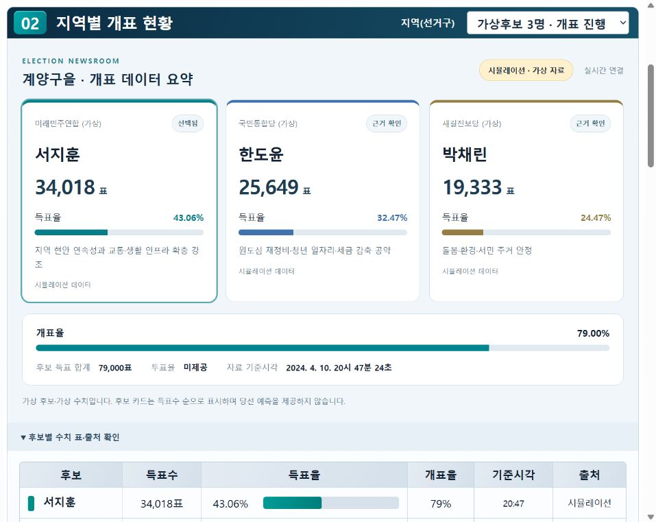
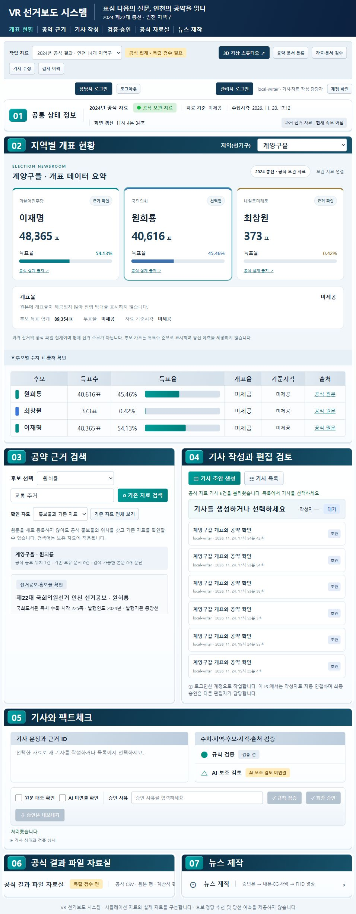
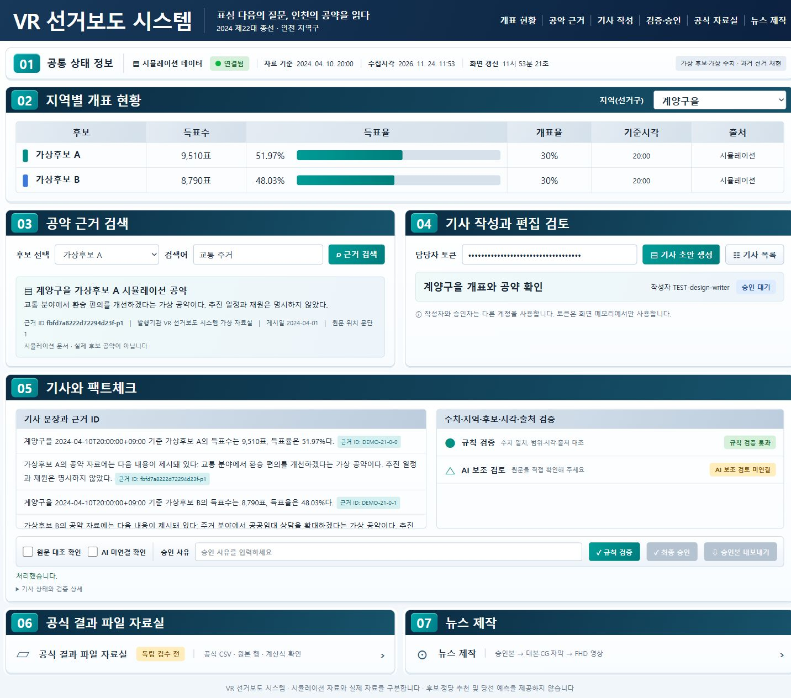
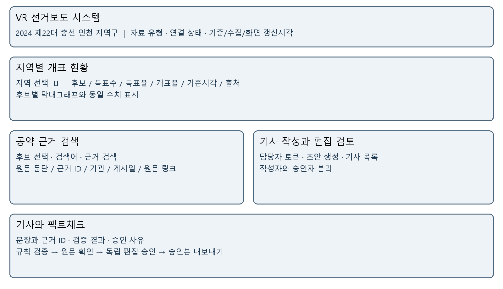
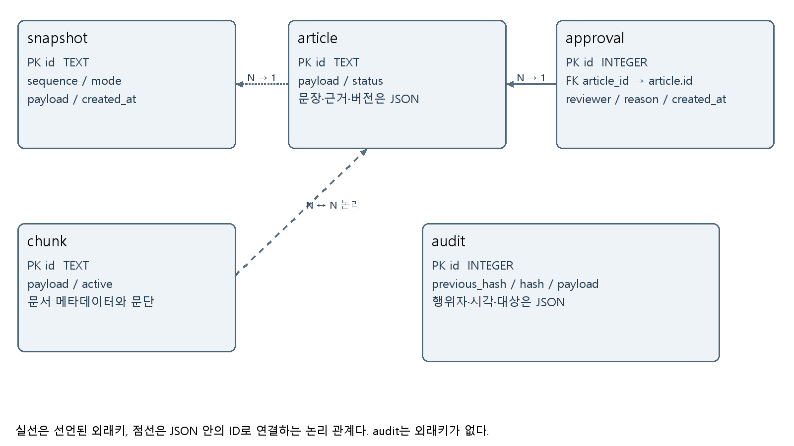

# VR 선거보도 시스템

**표심 다음의 질문, 인천의 공약을 읽다**

## 현재 가상 후보 설정

| 구분 | 후보명 | 정당(가상) | 캐릭터·핵심 메시지 |
| --- | --- | --- | --- |
| 가상 후보 1 | 서지도 | 미래민주연합 | 지역 현안 연속성과 교통·생활 인프라 확충 강조, 조직력 우위 |
| 가상 후보 2 | 한반도 | 국민통합당 | 원도심 재정비·청년 일자리·세금 감축 공약 내세운 추격자 |
| 가상 후보 3 | 박리본 | 새길진보당 | 돌봄·환경·서민 주거 안정을 앞세운 캐스팅보트·개혁 표심 공략 |

후보 색상: 서지도 **로열블루 #4169E1**, 한반도 **크림슨레드 #DC143C**, 박리본 **에메랄드그린 #009B77**. 수치 표·스튜디오 그래프에 적용하며 득표 순위가 바뀌어도 후보별 색상은 유지됩니다.

개표 카드는 기존 청록·파랑·황갈색 팔레트를 유지하고 후보 이름 옆에 정당명을 표시합니다. 카드의 ‘가상 후보 1·2·3’ 번호 문구는 표시하지 않으며, 후보별 수치 표에도 후보 옆 정당명을 표시합니다.

새 개표 자료·공약 검색·기사 생성·샘플 음성에 적용합니다. 기존 작성 기사와 승인·제작 기록은 당시 이름을 보존합니다. 이전 자동 공약 문단은 보존하되 신규 검색에서 제외합니다.

## 최신 시스템 실행 화면 연결

현재 이 PC에서 실행 중인 최신 시스템은 아래 링크로 열 수 있습니다.

- [PC 가상 스튜디오 열기](http://127.0.0.1:8202/studio)
- [선거보도 업무 화면 열기](http://127.0.0.1:8202/)

위 링크는 시스템을 실행한 PC에서 서버가 켜져 있을 때 사용할 수 있는 로컬 주소입니다. 현재 실행 포트는 8202이며, 아래 기본 실행 스크립트의 보도 서버 포트는 8102입니다.

## 담당자 토큰 재발급이 막힐 때

브라우저의 여러 탭은 로그인 상태를 공유합니다. 편집자로 로그인한 뒤 이전 관리자 탭에서 재발급을 요청하면 관리자 권한이 없어 거부됩니다. 관리자 화면은 재발급 대화상자를 열기 전과 실행 전에 현재 계정을 다시 확인하며, 권한 변경·세션 만료 시 **관리자로 다시 로그인**을 안내합니다. 성공하면 대화상자를 닫고 새 토큰 영역으로 이동합니다. 사용 중지 계정은 먼저 활성화해야 합니다. 기존 토큰 조회는 제공하지 않으며 재발급 시 해당 계정의 기존 토큰·세션이 만료됩니다.

## 로그인 상태에서 관리자 작업 모드 전환

관리자 로그인 후 관리 화면 또는 보도 업무 화면 상단의 **관리자 작업 모드**에서 **작성자 / 편집자 / 최종 승인**을 선택합니다. 작성자는 04 기사 생성, 편집자는 자료·문서 검수, 최종 승인은 05 화면으로 이동합니다. 로그아웃이나 토큰 재입력 없이 전환하며 현재 로그인 세션에 모드를 보존하고 전환 이력을 기록합니다. 실제 계정명은 관리자 그대로이며 독립 승인자 신원을 바꾸거나 자기 승인을 허용하지 않습니다. 모드 전환 시 기사 승인 확인란은 초기화됩니다.

## 관리자 보도 업무 권한

관리자는 계정관리와 함께 기사 작성·수정, 문서 등록, 자료·문서 검수, 최종 승인·내보내기·뉴스 제작을 수행합니다. 작성자·편집자의 기존 권한은 유지합니다. 관리자도 규칙 검증과 원문 대조를 거치며, 자신이 작성하거나 수정해 작성자가 된 기사 또는 자신이 등록한 자료를 직접 승인할 수 없습니다. 다른 작성자의 기사는 관리자가 최종 승인할 수 있습니다.

## 04 작성 기사 목록 관리

각 기사에 **선택 / 수정 / 삭제** 버튼을 제공합니다. 선택하면 본문과 05 검증 결과를 불러오고, 수정하면 사유를 입력해 새 버전으로 저장합니다. 수정본은 기존 승인을 이어받지 않습니다. 삭제는 확인창을 거쳐 목록에서 제외하며 원문·승인·감사 기록을 보존합니다. 작성자는 본인 기사만, 관리자는 전체 기사를 삭제할 수 있습니다. 삭제된 기사는 승인·내보내기·뉴스 제작 대상에서 제외되고 연결된 제작물 다운로드도 차단됩니다. 05의 **편집자 검토 확인**은 로그인 후 같은 기사 검토를 이어갑니다.

## WAV 파일 선택 목록

07의 **WAV 파일 선택**은 음성 출처와 같은 드롭다운입니다. WAV 3종 생성 후 표준 보도·차분한 해설·빠른 브리핑을 목록에서 선택하면 미리 듣기와 제작 음성에 함께 적용됩니다. **직접 파일 업로드…**를 선택하면 외부 PCM WAV 업로드 칸이 표시됩니다.

## 07 보도 대본과 WAV 3종

02 대본·내레이션은 승인 자료의 수치·공약을 보도 문체로 표현하며 낭독용 대본에서 ‘가상’과 설명용 문구를 제외합니다. 승인 원문·근거는 변경하지 않고 자료 유형 표시는 화면·제작 원장에 유지합니다. **보도 대본으로 WAV 3종 생성**을 누르면 같은 한국어 음성으로 **표준 보도 / 차분한 해설 / 빠른 브리핑** 파일을 생성합니다. 각 파일의 다운로드·미리 듣기·제작 적용이 가능하며 **녹음·외부 합성 음성 업로드 (PCM WAV)**도 이용할 수 있습니다. 선택 음성 길이에 맞춰 영상 길이를 조정합니다.

실행 확인용 하늘도시갑 사례: [표준 WAV](outputs/broadcast-narration/standard.wav) · [차분한 WAV](outputs/broadcast-narration/calm.wav) · [빠른 WAV](outputs/broadcast-narration/brief.wav) · [보도 대본](outputs/broadcast-narration/script.txt). [출처 원장](outputs/broadcast-narration/provenance.json)에 가상 자료 기반·합성 음성임을 보존합니다.

## 07 실제 뉴스 제작 작업실

07 팝업은 **기사·제작 순서 → 승인 대본·내레이션 → 제작 실행 → 완성 영상·이력**으로 구성합니다. 승인 기사만 선택할 수 있으며 화살표로 순서를 바꿉니다. **보도 대본으로 WAV 3종 생성**은 승인 자료를 보도 문체로 표현한 한국어 합성 PCM WAV 3종을 생성합니다. 음성을 미리 듣고 길이를 확인한 뒤 **FHD 영상 제작 시작**을 누르세요. 영상은 1920×1080·25fps의 CG·자막형 MP4이며 제작 완료 후 **완성 영상 재생**으로 팝업에서 확인합니다. WAV 음성을 포함한 제작 패키지와 SRT·대본·제작 원장을 다운로드할 수 있습니다.

- 음성 자동 생성: Windows의 Microsoft Heami TTS 필요. 설치되지 않은 환경은 외부 PCM WAV 업로드를 이용합니다.
- 선택 기사나 순서를 바꾸면 생성 음성을 다시 만들어야 합니다. 기사 승인 철회·내용 변경 시 생성 음성 접근도 차단합니다.
- 음성보다 영상이 짧으면 제작을 차단합니다. 음성이 없는 제작은 **음성 없이 자막형 영상으로 제작**을 명시적으로 선택합니다.
- 가상 샘플 3종은 보조 자료로 접어 두며 승인 기사 본문 음성과 구분합니다.
- 3D 스튜디오의 카메라 영상을 녹화·합성하는 기능과는 구분되며, 현재 제작 결과는 승인 기사에 기반한 CG·자막 영상입니다.

## 07 샘플 내레이션과 음성

뉴스 제작 팝업에서 샘플을 선택하고 대본·미리 듣기·WAV/TXT 다운로드를 이용합니다. **이 샘플을 제작에 사용**을 누르면 음성 출처가 합성 음성으로 설정되고 기본 영상 길이를 음성 길이에 맞춰 늘립니다. 승인 기사를 체크하고 **FHD 뉴스 제작**을 누르세요. 업로드한 음성을 선택하면 샘플 적용이 해제됩니다. 고정 샘플 대본이며 선택 기사의 본문을 자동 낭독하는 기능은 아닙니다. 하늘도시갑 가상 기사 제작에서만 적용합니다.

| 샘플 | 길이 | 대본 | 한국어 PCM WAV |
| --- | --- | --- | --- |
| 오프닝 · 가상 개표 소개 | 23.07초 | [TXT](election-news-server/static/samples/narration/opening.txt) | [WAV](election-news-server/static/samples/narration/opening.wav) |
| 가상 후보 세 명의 공약 소개 | 34.8초 | [TXT](election-news-server/static/samples/narration/candidates.txt) | [WAV](election-news-server/static/samples/narration/candidates.wav) |
| 팩트체크 안내와 마무리 | 27.62초 | [TXT](election-news-server/static/samples/narration/closing.txt) | [WAV](election-news-server/static/samples/narration/closing.wav) |

음성은 설치된 Microsoft Heami Windows TTS로 생성한 합성 음성입니다. 22,050Hz·모노·16bit PCM WAV이며 대본은 프로젝트용으로 작성했습니다. 원본 대본과 파일 해시·길이는 [샘플 카탈로그](election-news-server/static/samples/narration/index.json)에 보존합니다. Windows에서 같은 음성이 설치되어 있으면 `scripts/generate_narration_samples.ps1`로 재생성할 수 있습니다.

## 승인 대기에서 뉴스 제작으로

05 상단에서 기사 상태를 확인합니다. 편집자로 로그인한 뒤 **원문 대조 확인**, **AI 미연결 확인**, **승인 사유 5자 이상**을 입력하고 **검토 완료·최종 승인**을 눌러야 승인 완료가 됩니다. 편집자 로그인·규칙 검증만으로 자동 승인하지 않습니다. 승인 전에는 제작 버튼이 **최종 승인 후 뉴스 제작**으로 표시됩니다. 다른 탭에서 승인했다면 **기사 상태 새로고침**을 누르세요.

## 기사 제작 흐름 개선

04에서 후보와 제목을 선택하고 **기사 초안 생성**을 누르면 초안 생성과 규칙 검증을 연속 실행합니다. 후보 선택은 작성 후보에도 반영하며, 전체 후보 기사는 작성 후보에서 명시적으로 선택합니다. **05 검증·승인 결과 보기**로 이동하면 실패 원인, 자기 승인 제한, 확인란·승인 사유 중 누락된 항목을 안내합니다. **편집자 검토 확인**를 사용하면 로그인 후 동일 기사·선거구·작업 자료를 다시 엽니다. 최종 승인 후 **승인 기사로 뉴스 제작**으로 연결합니다. 실제 원문 대조와 독립 승인 확인은 자동 처리하지 않습니다.

## 03 근거 확인 선거구의 가상 선택

03 하단의 **근거 확인 선거구**에는 **하늘도시갑 · 가상 후보 공약**이 항상 표시됩니다. 선택 후 **하늘도시갑 04 공약 근거 확인**을 누르면 기사를 선택하지 않아도 가상 후보 공약으로 이동합니다. 실제 언론 기사를 가상 후보의 근거로 연결하지 않으며 실제 선거구 기사의 기존 전달 방식은 유지합니다.

## 04 가상 후보와 기본 선거구

2026-11-26부터 가상 선거구의 명칭은 **하늘도시갑**입니다. 실제 2024년 계양구을 선거 결과와 기존에 저장된 기사·원본 이력은 변경하지 않습니다.

공약 근거 선거구의 기본값은 **하늘도시갑 · 가상 후보 3명 (기본)**입니다. 후보 선택에서 **서지훈 · 가상 후보 1 / 한도윤 · 가상 후보 2 / 박채린 · 가상 후보 3**을 선택합니다. 가상 후보를 변경하면 해당 후보의 전체 공약 자료를 표시하며, 실시간 수치 갱신에도 후보 선택을 유지합니다. 실제 선거구 자료를 보려면 별도로 **2024년 실제 결과** 항목을 선택하세요.

## 기사 제목 자동 생성

04의 생성할 기사 제목은 선거구·작성 후보·기사 유형에 맞춰 자동 입력합니다. 자동 제목은 선택 조건이 바뀌면 갱신하며 직접 입력한 제목은 유지합니다. **제목 자동 생성**을 누르면 현재 조건으로 다시 만듭니다. 빈 제목으로 생성해도 자동 제목을 적용합니다. 예: `하늘도시갑 서지훈(가상 후보 1) 개표 현황과 공약 자료`.

## 04 기사 초안 생성

기사 제목을 입력한 뒤 **기사 초안 생성**을 누르면 자료 확인이 진행 중인 상태에서도 초안을 작성합니다. 등록된 공약 본문과 선택한 참고 기사·공식 수치를 사용하며, 근거가 없는 공약은 만들지 않습니다. 자료 확인 미완료 안내를 표시하고 05의 검증·독립 승인 절차는 유지합니다. 제목이 비어 있으면 입력 위치로 안내합니다.

## 기사·후보 전체 선택

03의 **후보 선택 → 전체 후보 선택**으로 전체 후보 기사를 조회합니다. **검색 기사 전체 선택**은 현재 조건에 맞는 기사 전체(더보기 안의 항목 포함)를 선택하며 **검색 기사 선택 해제**로 해제합니다. 구글 결과도 참고 기사로 개별·전체 선택할 수 있으며 하단 버튼으로 04에 전달합니다. 서로 다른 선거구의 기사를 함께 선택하면 근거 확인 선거구를 고를 수 있으며, 해당 지역 기사만 04로 연결합니다. 연결 지역과 기사 수를 버튼 옆에 표시합니다.

## 구글 뉴스 검색

03 기사 검색에는 기존 확인 기사 목록과 **구글 뉴스 검색**이 함께 있습니다. 지역·후보·기간·보도 시점을 설정한 뒤 **구글 뉴스 검색 결과 불러오기**를 누르면 Google News RSS의 제목·언론사·보도일·링크를 최대 30건 표시합니다. 처음 5건 이후에는 더보기로 펼칩니다. 결과는 5분간 캐시하며 연결 실패·0건을 별도로 안내합니다. 구글에서 직접 검색하는 링크도 제공합니다. 선택한 결과는 04 참고자료로 연결하며 서버가 수집한 메타데이터를 해시 ID와 함께 보존합니다. 기사에는 제목·언론사·보도일·링크만 사용하고 원문 본문 미확인을 명시합니다. 검색 선거구는 참고자료의 사용 범위이며 내용 관련성 검증 완료를 의미하지 않습니다.

## 가상 후보 설정

기본 시뮬레이션의 후보 카드·공약 근거·기사 생성에는 다음 사용자 지정 설정을 사용합니다. 모두 가상 후보·가상 정당이며 실제 선거 결과와 구분합니다.

| 구분 | 후보명 | 정당(가상) | 캐릭터·핵심 메시지 |
| --- | --- | --- | --- |
| 후보 1 | 서지훈 | 미래민주연합 | 지역 현안 연속성과 교통·생활 인프라 확충 강조, 조직력 우위 |
| 후보 2 | 한도윤 | 국민통합당 | 원도심 재정비·청년 일자리·세금 감축 공약 내세운 추격자 |
| 후보 3 | 박채린 | 새길진보당 | 돌봄·환경·서민 주거 안정을 앞세운 캐스팅보트·개혁 표심 |

공약 본문은 위 설정 범위에서만 구성하며 구체적인 예산·일정은 만들지 않습니다. 캐릭터 설정은 후보 소개 정보이며 검증된 선거 분석이나 예측 근거로 사용하지 않습니다. 기존 기사와 원본 기록은 보존합니다.



## 통합 로그인 안내

[통합 로그인](http://127.0.0.1:8202/login)에서 관리자·작성자·편집자 계정을 함께 사용합니다. 역할은 서버가 확인하며 관리자는 계정관리, 작성자·편집자는 보도 업무로 이동합니다. 기존 관리자 로그인 주소도 통합 화면으로 연결됩니다.

## React 개표 화면 업데이트 · 2026-11-25

[선거보도 업무 화면](http://127.0.0.1:8202/)에 **React 후보 카드·개표 요약·기사 상태 목록**을 반영했습니다. 후보 카드의 근거 확인은 03 후보 선택으로 연결됩니다. 데이터와 수치 표는 기존 WebSocket을 공유하며, 공식 원본의 결측값은 미제공으로 유지합니다. 기존 토큰 없는 기사 생성·목록과 검증·승인 절차도 연결됩니다.



[PDF 검토·적용 기록](docs/react-dashboard-review.md)과 [React 소스](frontend/README.md)를 참고하세요. 일반 실행은 기존과 같으며 React 빌드 산출물이 포함되어 있습니다.

## v2 PC 가상 스튜디오와 통합 보도 업무

PC에서 조작하는 **실제 3D 가상 스튜디오**와 자료 검수부터 FHD 제작까지의 업무 화면을 제공합니다. 3D 엔진은 프로젝트에 포함되어 실행 중 CDN 연결이 필요하지 않습니다.


| 기능 | 실제 동작 |
| --- | --- |
| PC 3D 스튜디오 | 마우스 회전·확대, 정면/좌우/전체 카메라, 지역별 결과, 승인 대본, 브라우저 읽기, PNG 캡처 |
| 공식 결과 모드 | 인천 14개 지역구·38명 후보의 원본 해시·원본 행별 후보·득표수·누락 여부 확인, 미제공 시각·개표율 보존, 독립 검수 상태 |
| 문서 등록 | 공식 URL·게시일·후보·권리·본문, 텍스트 PDF 추출과 원본 보존, 청크·근거 ID |
| 독립 검수 | 등록자와 다른 editor의 자료·공약 검수, 반려·철회, 실제 기사 승인 차단 |
| 기사 업무 | 근거 기반 정형 초안, 새 수정 버전, 수치/출처 검증, 독립 승인, JSON 내보내기 |
| FHD 제작 | 승인 기사 선택 → 실제 MP4·SRT·대본·CG·제작 원장·ZIP, 최대 20분 |
| 음성 | 제공한 PCM WAV 결합. 직접 녹음/AI 합성 여부를 표시하며, 없으면 무음으로 명시 |
| 보존 | SQLite 7개 테이블, 감사 해시 점검, DB·원문 백업, 재시작 시 중단 제작 작업 실패 처리 |

처음 실행은 PowerShell에서 `./setup.ps1`입니다. 설치 후 재실행은 `./start.ps1`입니다. 업무 화면은 **http://127.0.0.1:8102**, 가상 스튜디오는 **http://127.0.0.1:8102/studio**입니다. [운영 안내](docs/platform-guide.md)에 역할별 절차, Docker 설정, 제작·복구 방법을 정리했습니다.

공식 결과는 불러왔지만 **사람의 독립 대조를 완료한 것으로 표시하지 않습니다**. 실제 후보 공약 본문을 등록하고 자료·문서 검수와 기사 승인을 거쳐야 실제 자료의 제작물을 내보낼 수 있습니다. 사람의 승인과 가상 TEST 계정의 시험은 구분합니다. 외부 생성형 AI와 HMD 장비 연동은 이 PC 버전에 포함하지 않습니다.

2024년 제22대 국회의원선거 인천 지역구를 대상으로 공식 개표 데이터와 공약 근거를 연결하고, 기사 초안 → 팩트체크 → 독립 편집 승인 → 뉴스 제작으로 이어지는 선거보도 시스템입니다.

이 저장소는 기획·설계 문서 7종, 실제 실행 소스코드, DB SQL 스크립트와 검증·형상관리 기록을 함께 제공합니다. 2026년 11월 24일에 기존 [Real-time-Election-News](https://github.com/mbc-incheon/Real-time-Election-News)의 로컬 후속 수정본을 통합했습니다. 기존 작업 폴더의 미커밋 수정은 보존했습니다.

사용자 지정에 따라 검증된 [election-analysis-project-01의 통합본 00ac79d](https://github.com/mbc-incheon/election-analysis-project-01/commit/00ac79dc6ec77d6bd4c1e883e152fd78f2e3ab91)를 **VR-Election-News**에 직접 커밋했습니다. 현재 저장소의 [변경 기록](https://github.com/mbc-incheon/VR-Election-News/commits/main/)과 [자동 시험](https://github.com/mbc-incheon/VR-Election-News/actions)을 확인할 수 있습니다.

## 구현 결과물과 실행

| 산출물 | 위치 | 제공 내용 |
| --- | --- | --- |
| 데이터 송신 서버 | [election-data-server](election-data-server) | 공식 입력 검사·원본/원장·이벤트 이력·WebSocket 송신 |
| 보도 서버와 화면 | [election-news-server](election-news-server) | 대시보드·근거 검색·초안·검증·독립 승인·JSON 내보내기 |
| DB 스크립트 | [db](db/README.md) | CREATE TABLE·INSERT·무결성/조회 SQL·초기화 도구 |
| 검증 결과 | [구현 결과서](docs/implementation-results.md) | 단위/API/영상 57개·서버 통합 13개·전체 제작 통합 24개·화면 로직 10개 |
| 형상관리와 협업 | [실제 기록과 협업 절차](docs/collaboration.md) | 커밋 이력·출처·PR 양식·자동 시험 설정 |
| 기존 발표와 영상 | [2026-11-20 자료 보관함](outputs/archive/20261120) | PPT·20분 검토 영상·대본·자막·기존 보고서 |

Python 3.12 이상에서 저장소 루트에서 실행합니다.

```powershell
python -m venv .venv
.venv/Scripts/python.exe -m pip install -r requirements.txt
./start.ps1
```

브라우저에서 http://127.0.0.1:8102를 엽니다. 첫 실행에 표시되는 writer/editor 토큰은 서로 다른 담당자가 사용합니다. 담당자는 별도 로그인 화면에서 계정으로 로그인합니다. 업무 화면에서는 로그인 세션으로 작업하며 토큰을 반복 입력하지 않습니다. 종료는 실행 터미널에서 `Ctrl+C`입니다. 화면의 기본 자료는 2024년 공식 파일 집계이며 작업 자료 메뉴에서 시뮬레이션으로 전환합니다. 현재 선거 속보가 아닙니다.

데이터 서버는 8101, 보도 서버는 8102입니다. API 상세는 각 서버의 `/docs` 및 [OpenAPI JSON](outputs/openapi_news.json)에서 확인합니다. PC 스튜디오는 WebGL 3D이며 외부 생성형 AI와 몰입형 VR 기기 연동은 현재 없습니다.

```powershell
# 별도 DB에 CREATE TABLE과 INSERT 예제 적용
.venv/Scripts/python.exe scripts/init_db.py --path runtime/sql-demo/news.sqlite --demo

# 검증 재현
.venv/Scripts/python.exe -m pytest tests -q
.venv/Scripts/python.exe scripts/integration_test.py
.venv/Scripts/python.exe scripts/platform_integration.py
# Node.js가 있으면 화면 승인 제어 로직도 확인
node scripts/check_ui.mjs
```

SQL 예제의 기사는 DRAFT, 승인 테이블은 0건입니다. 실제 담당자의 편집 승인을 만들지 않습니다. 정상 흐름은 자료 수신 → 검색 → 초안 → 규칙 검증 → 다른 editor의 원문 확인·사유 입력 → 승인본 내보내기입니다. 오류 기사·자기 승인·미확인 근거는 서버에서 차단합니다.

## 프로젝트 개요

| 구분 | 내용 |
| --- | --- |
| 프로젝트명 | VR 선거보도 시스템 |
| 보도 주제 | 표심 다음의 질문, 인천의 공약을 읽다 |
| 선거 범위 | 2024년 제22대 총선 인천 지역구 14곳 |
| 일정 | **2026년 11월 18일~11월 30일** — 최신 WBS 기준 |
| 핵심 기능 | 공식 자료 수집·원본 보존, WebSocket 갱신, 근거 검색, 문장별 출처 추적, 규칙 검증, 독립 편집 승인 |
| 제작 목표 | 승인 기사와 동일 데이터로 20분 이내 FHD 뉴스 제작 |
| 편집 원칙 | 후보·정당 지지나 공격, 출처 없는 주장, 당락 예측 배제 |

## 산출물 바로가기

문서 링크를 연 뒤 GitHub의 다운로드 기능으로 Word 파일을 받을 수 있습니다. 문서는 모두 수정 가능한 `.docx` 형식입니다.

| 단계 | 산출물 | 포함 내용 | 분량 |
| --- | --- | --- | --- |
| 기획 | [01 기획서](docs/deliverables/01_기획서.docx) | 목적·배경·목표·기능 정의·중립성·**팩트체크 20개 항목** | 7쪽 |
| 기획 | [02 요구사항 정의서](docs/deliverables/02_요구사항_정의서.docx) | 사용자 요구 7개·기능 요구 18개·비기능 요구·인수 시험 | 6쪽 |
| 기획 | [03 WBS](docs/deliverables/03_WBS_역할분담과_일정관리.docx) | 6개 역할·18개 작업·선행 관계·일정표·완료 기준 | 6쪽 |
| 설계 | [04 화면 설계서](docs/deliverables/04_화면_설계서.docx) | UI/UX 화면 구성·메뉴 구조·화면별 동작·오류 처리·디자인 초안 이미지 | 5쪽 |
| 설계 | [05 ERD 및 데이터베이스 설계서](docs/deliverables/05_ERD_데이터베이스_설계서.docx) | ERD·테이블 5개·컬럼·자료형·키·JSON 참조·무결성 | 4쪽 |
| 설계 | [06 API 명세서](docs/deliverables/06_API_명세서.docx) | 프론트엔드 ↔ 백엔드 요청·응답·권한·오류·WebSocket | 5쪽 |
| 설계 | [07 시스템 아키텍처 설계서](docs/deliverables/07_시스템_아키텍처_설계서.docx) | 전체 서비스 구성도·데이터 흐름·장애 대응·승인 통제 | 4쪽 |

WBS의 56시간은 작업 배분 계획이며 팀원별 실제 투입 시간은 아닙니다. 담당자 실명과 실제 완료 기록은 팀에서 확정합니다.

## 화면 구성과 메뉴

첨부 디자인을 기준으로 **01~07 번호 영역, 남색 상단 메뉴, 후보별 득표율 막대, 근거 검색·기사 작성의 두 열 배치, 기사·팩트체크 카드와 승인 도구 모음**을 실제 화면에 적용했습니다. 이미지를 배경으로 붙인 화면이 아니라 API와 WebSocket에 연결된 HTML 화면입니다.



[모바일 실행 화면](outputs/screenshots/dashboard-mobile.jpg)에서는 한 열 배치와 표 내부 가로 스크롤을 사용합니다. 두 캡처는 TEST 작성자와 시뮬레이션 자료로 확인한 화면입니다. 실제 편집 승인을 수행하지 않았습니다.

공통 상태 → 지역별 개표 현황 → 공약 근거 검색 → 기사 작성 → 검증과 승인 → 공식 자료실 → 뉴스 제작 안내 순서로 구성합니다. 현재 기본 화면은 하나의 웹 페이지 안에 기능 구역을 배치한 구조입니다.



화면설계서에 포함한 [디자인 초안](docs/images/VR_선거보도_시스템_화면디자인_초안_v1.png)과 [주요 화면 구성 이미지 초안](docs/images/VR_선거보도_시스템_주요화면구성_이미지초안_v1.png)도 확인할 수 있습니다. 이미지는 디자인 자료이며 실행 화면의 캡처가 아닙니다.

화면 수정은 `election-news-server/dashboard.template.html`, `dashboard.css`, `dashboard.js`에서 진행하고 `python scripts/build_dashboard.py`로 서버가 제공하는 `index.html`을 갱신합니다. 빌드 결과도 저장소에 포함되어 첫 실행에 별도 프런트엔드 설치가 필요하지 않습니다.

## 데이터베이스 구조

현재 보도 서버는 SQLite의 `snapshot`, `chunk`, `article`, `approval`, `audit`에 **`review_record`와 `render_job`을 추가한 7개 테이블**을 사용합니다. 신규 테이블은 [004_workflow.sql](db/004_workflow.sql)에 있습니다. 아래 v1 ERD의 실선은 실제 외래키, 점선은 JSON 내부 ID를 이용한 논리 관계입니다. v2 자료 검수·제작 관계는 [운영 안내](docs/platform-guide.md)를 참조하세요.



## 전체 서비스 구성

데이터 송신 서버는 개표 이벤트를 전달하고, 보도 서버는 근거 검색·기사 작성·검증·승인을 담당합니다. 브라우저는 보도 서버에 연결하며, 내보낸 승인본을 대본·CG·자막 제작에 사용합니다.


| 구간 | 통신과 처리 |
| --- | --- |
| 데이터 송신 서버 → 보도 서버 | HTTP 이벤트 이력 조회 + WebSocket 수신, 해시로 중복 방지 |
| 보도 서버 ↔ 브라우저 | HTTP 조회·작성·검증·승인 + WebSocket 화면 갱신 |
| 기사 → 편집 승인 | 규칙 검증 후 작성자와 다른 편집자의 원문 확인과 승인 사유 기록 |
| 승인본 → 뉴스 제작 | 기사 문장·근거 ID·스냅샷 ID를 같은 버전으로 사용 |

## 팩트체크 20개 항목

기획서 5~7쪽에 항목별 확인 기준과 오류·미확인 시 조치를 정리했습니다.

| ID | 확인 항목 | ID | 확인 항목 |
| --- | --- | --- | --- |
| FC01 | 선거 범위 | FC11 | 공약 원문과 주체 |
| FC02 | 지역구 식별 | FC12 | 인용과 공약 맥락 |
| FC03 | 후보와 정당 | FC13 | 정정과 철회 |
| FC04 | 원본 출처 | FC14 | 문장별 근거 연결 |
| FC05 | 집계 범위와 중복 | FC15 | 제목과 보도 표현 |
| FC06 | 득표수와 합계 | FC16 | 규칙과 AI 판정 |
| FC07 | 득표율과 차이 | FC17 | 독립 편집 승인 |
| FC08 | 개표율과 투표율 | FC18 | 승인본과 제작물 |
| FC09 | 기준시각과 시간대 | FC19 | 시각화와 AI 표시 |
| FC10 | 실제 자료와 재현 | FC20 | 감사와 최종 재검증 |

이 목록은 검수 기준이며 20개 항목을 이미 통과했다는 뜻은 아닙니다. 보도에 영향을 주는 실패·미확인 항목은 해결 전 승인하지 않습니다.

## 자료와 구현 상태

- 공식 결과와 가상 후보·공약·수치는 분리하며, 가상 자료에는 시뮬레이션 데이터를 표시합니다. 2024년 자료를 현재 선거 속보로 표현하지 않습니다.
- 실제 공식 결과 집계의 독립 대조와 실제 후보 공약 본문 확보·검수는 남은 작업입니다. 공식 원문이 제공하지 않은 기준시각·개표율·투표율을 임의로 채우지 않습니다.
- 현재 근거 검색은 문단 키워드 검색이며, 초안은 근거를 연결한 정형 문장 방식입니다. 외부 생성형 AI·임베딩·벡터 DB는 연결되지 않았습니다.
- PC 3D 가상 스튜디오를 실제 구현했습니다. 사용자 선택에 따라 HMD·WebXR은 현재 범위에서 제외했습니다.
- 기존 Word 문서 7종은 v1 기획·설계 기준을 보존합니다. 이후 구현한 v2 검수·제작·3D 스튜디오의 기준은 운영 안내와 최신 API/SQL입니다.

공식 데이터 정보원: [공공데이터포털 선관위 선거 결과 파일](https://www.data.go.kr/data/15025527/fileData.do)

## 문서 구성

```text
docs/
├── deliverables/       # 최신 기획·설계 Word 문서 7종
├── images/             # 화면 배치도·ERD·서비스 구성도
├── project-plan.md     # 초기 기획 참고 자료
├── functional-spec.md  # 초기 기능 참고 자료
└── system-design.md    # 초기 설계 참고 자료

election-data-server/   # 데이터 송신 실제 소스
election-news-server/   # 보도 API·SQLite·브라우저 화면
db/                    # CREATE·INSERT·검수 SQL
scripts/               # 실행 보조·DB 초기화·통합 시험
tests/                 # 단위·SQL 시험
data/                  # 공식 원본·수집 원장·정제본
outputs/               # 최신 시험 결과와 기존 자료 보관함
.github/               # 자동 시험과 PR 양식
```

기존 [초기 기획서](docs/project-plan.md), [초기 기능정의서](docs/functional-spec.md), [초기 설계서](docs/system-design.md)는 참고 자료입니다. 현재 구현 상태는 [v2 운영 안내](docs/platform-guide.md), API와 SQL을 기준으로 확인합니다.

### 관리자 로그인과 담당자 발급

업무 화면 상단의 **관리자 로그인** 또는 `/admin/login`에서 관리자 아이디와 토큰으로 로그인합니다. 로그인 후 `/admin`에서 작성자·편집자 계정을 발급할 수 있습니다. 새 토큰은 한 번만 표시되며 기존 토큰·해시는 화면에 노출하지 않습니다.

최초 설치는 작성자·편집자·관리자 토큰을 발급합니다. 기존 설치에 관리자만 추가하려면 프로젝트 폴더에서 `.\.venv\Scripts\python.exe scripts\init_users.py --add-admin`을 실행하세요. 기존 계정이 있으면 보존하며, 관리자 아이디는 `admin`입니다. 실제 토큰은 GitHub에 저장하지 않습니다. 관리자는 기사 최종 승인 권한을 갖지 않습니다.

계정관리 완성본: `/admin`에서 담당자 이름·아이디·역할 발급, 계정 검색·필터·사용 상태 변경·토큰 재발급·최근 로그인·관리 이력을 확인합니다. 담당자는 `/login`에서 로그인하며 업무 화면에 역할이 반영됩니다. [자세한 운영 절차](docs/platform-guide.md#계정-관리-전체-흐름)를 확인하세요.

04 공약 근거 검색에는 [국회도서관 공식 선거공보 목차](https://dl.nanet.go.kr/detail/NONB12025000019286)를 대조한 인천 14개 지역구·38명 후보의 수록 위치를 추가했습니다. 목차와 실제 공약 본문은 구분하며, 본문 미등록 시 근거 0건을 유지합니다. 후보별 출처·쪽수·보유 문서 현황과 홍보물/기존 자료 선택을 제공합니다. 04에서는 새 원문 등록 없이 자료를 확인합니다.

### 로그인 만료·관리자 토큰 복구

Windows에서는 프로젝트 폴더의 **[관리자_토큰_관리.cmd](관리자_토큰_관리.cmd)** 파일을 더블클릭하세요. **1번**은 기존 관리자 토큰 안내 파일을 메모장으로 엽니다. **2번**은 `재발급`을 입력해 확인한 뒤 새 토큰을 발급하고 파일을 엽니다. 로그인 세션만 만료됐다면 1번으로 기존 토큰을 확인해 다시 로그인하면 됩니다. 재발급 시 기존 관리자 토큰과 세션이 만료되며 작성자·편집자 계정은 유지됩니다.

### 로그인 화면에서 관리자 토큰 재발급

`/admin/login`의 **관리자 토큰을 잊으셨나요? · 토큰 재발급**을 누르세요. 기존 관리자 토큰 또는 `runtime/news/admin-recovery.txt`의 로컬 복구 코드로 본인 확인 후 새 토큰을 발급합니다. 복사·안내 파일 저장·새 토큰으로 로그인을 지원하며 기존 관리자 토큰과 세션은 만료됩니다. 시스템을 실행한 PC에서만 사용 가능합니다. 로그인 세션만 만료된 경우 기존 토큰으로 다시 로그인하세요.

### 03 홍보물·기존 자료 확인

지역·후보를 선택하고 **확인 자료**에서 **선거공보·홍보물** 또는 **기존 보유 자료**를 고르세요. 홍보물은 국회도서관·선관위·정책공약마당 링크와 후보별 목차 쪽수를 안내합니다. 검색어는 기존 보유 본문에 적용되며, 외부 홍보물은 해당 사이트에서 직접 열어 확인합니다. 새 원문 등록은 이 열람 흐름의 필수 단계가 아닙니다. 외부 열람만으로 기사 근거 확보나 검증 통과로 표시하지 않습니다.

### 04 토큰 입력 없는 기사 작성과 목록

03의 담당자 토큰 입력란을 제거했습니다. **기사 초안 생성**과 **기사 목록**은 로그인한 세션을 사용하고, 이 PC의 로컬 실행에서는 미로그인 상태도 작성자로 자동 연결합니다. 목록은 현재 작업 자료(공식/시뮬레이션)의 기사만 표시하며, 작업 자료를 바꾸면 이전 목록을 비웁니다. 최종 승인은 다른 편집자가 담당자 로그인으로 연결해 진행합니다.

공식 최종 집계 화면의 개표율은 요청한 표시값 100%, 기준시각은 임의 설정한 2024.04.11 06:00(한국시간)입니다. 화면 설정값임을 표시하며 원본 데이터나 기사 근거는 변경하지 않습니다.

### 가상 개표 진행

업무 화면은 가상후보 3명의 개표율 0~100% 반복 진행을 기본으로 표시합니다. 기본 1초마다 1%씩 갱신하며 득표수는 누적 증가하고 득표율은 매 구간 가상 표 배분에 따라 달라집니다. 100% 이후 새 회차 0%로 돌아갑니다. 회차당 1시간의 가상 기준시각을 압축해 표시합니다. 실제 개표 기록이 아니며 공식 결과는 작업 자료에서 별도로 선택합니다.

### 지난 선거 후보별 결과 조회

[지난 선거 결과 보기](http://127.0.0.1:8202/#past-results)에서 2024년 제22대 총선 인천 14개 지역구, 38명의 공식 최종 득표수·득표율·정당·출처를 확인합니다. 선거구 선택과 후보·정당 검색을 제공하며 가상 개표를 중단하거나 작업 자료를 전환하지 않고 조회할 수 있습니다.

### 지역 선택으로 실제 후보 결과 확인

처음에는 가상후보 3명의 0~100% 개표 진행을 표시합니다. 02 지역(선거구) 목록에서 인천 지역구를 선택하면 작업 자료가 공식 결과로 전환되며 해당 지역 실제 후보의 최종 득표수·득표율을 개표 현황에 표시합니다. 목록의 “가상후보 3명 · 개표 진행”을 선택하면 가상 진행으로 돌아갑니다.

03 기사 작성 영역은 선택 지역·자료 종류의 기사 목록을 표시합니다. 초안 생성 직후 본문 미리보기와 목록을 함께 갱신하며, 지역을 바꾸면 이전 지역 기사를 지우고 해당 지역 목록을 조회합니다. 본문의 데이터 행 근거와 최종 승인 검토는 05 영역에서 확인합니다.

지난 선거 결과는 기본적으로 접힌 상태이며 제목을 누르면 펼쳐집니다. 03의 “지역선거구”에서 지역을 선택하거나 “기사 검색”을 누르면 해당 지역 기사 목록을 조회합니다. 02와 03의 선거구는 동기화되며 초안 생성도 같은 지역을 사용합니다.

### 03 기사 검색과 기사 작성

선택 지역의 후보별 실제 언론 기사 색인을 검색합니다. 기본 기간은 2024.04.03~04.17이며 후보·시작일·종료일·선거 전/당일/후로 필터링합니다. 확인한 보도의 제목·언론사·보도일·원문 링크만 표시하며 전체 언론을 실시간 검색하는 기능은 아닙니다. “인터넷 뉴스 원문 더 찾기”는 같은 후보와 기간의 외부 뉴스 검색으로 이동합니다. 직접 생성한 초안과 외부 보도는 구분하고, 보도 내용을 승인 근거로 자동 사용하지 않습니다. 색인 출처는 각 기사 링크와 static/election-news-index.json에 기록했습니다.

화면 순서는 03 기사 검색과 기사 작성, 04 공약 근거 검색으로 변경했습니다. 상단 메뉴와 초안 생성 안내도 같은 순서를 따릅니다.

### 완성된 기사 작성 흐름

1. 03에서 지역선거구와 작성 후보를 선택합니다.
2. 기사 유형을 개표 결과 / 후보 공약 비교 / 선거 전후 보도 정리로 선택합니다. 보도 정리는 위 뉴스 목록에서 참고 보도를 체크해야 합니다.
3. 기사 초안 생성을 누르면 생성 시점 자료를 고정하고 제목·요약·본문·문장별 근거·출처를 표시합니다. 생성 방식은 근거 기반 문장 템플릿입니다. 외부 뉴스 원문을 자동 요약하거나 복제하지 않고 참고 링크로 보존합니다.
4. 본문과 제목을 수정하고 사유를 입력해 새 버전으로 저장합니다. 요약은 첫 본문 문장으로 갱신되며 이전 버전과 승인을 승계하지 않습니다.
5. 작성 기사 목록은 지역별로 구분하고 제목·후보명·상태로 검색합니다. 실제/가상 구분·작성자·작성일·버전·상태를 표시합니다.
6. 05에서 규칙 검증 후 다른 편집자가 승인합니다. 공식 원본 독립 검수 미완료, 수치 불일치, 공약 근거 누락, 보도 참고자료 변조 시 승인을 차단합니다.

초안 생성 버튼 옆에는 작성 가능·생성 중·작성자 계정 필요 사유가 표시됩니다. 전체 서버 검사 63건, 프론트 검사 12건과 지역/기사 선택 검사를 통과했습니다.

### 03 ↔ 04 자료 확인 연결

03에서 지역선거구·작성 후보·기사 유형을 선택하고 **04 공약 근거 확인하기**를 누릅니다. 같은 지역과 후보가 04에 연결됩니다. 자료·출처와 근거 유무를 확인한 뒤 확인란을 체크하고 **확인 후 기사 생성으로 이동**을 누르면 03의 기사 생성 위치로 돌아옵니다. 선택 내용을 유지하며 초안 생성 버튼이 활성화됩니다.

지역 후보 전체를 선택한 경우 후보별로 차례로 확인합니다. 지역·후보를 바꾸거나 새로고침하면 확인을 다시 진행합니다. 이 확인은 현재 화면의 작성 준비 절차이며, 공약 근거 등록이나 독립 편집 승인과는 별개입니다. 근거 없는 공약 문장은 생성하지 않으며 최종 승인은 기존 05 검증을 따릅니다.

03 기사와 04 근거 검색은 같은 높이로 정렬하며 내부 검색 결과·기사 본문의 높이 제한을 제거했습니다. 편집 본문 입력창도 내용 길이에 따라 자동 확장됩니다. 긴 내용은 페이지 전체 스크롤로 읽으며 작은 내부 스크롤을 별도로 조작하지 않습니다. 좁은 화면에서는 두 영역을 세로로 배치합니다.

03의 기사 초안 생성과 기사 목록은 전용 팝업으로 열립니다. 목록 항목을 선택하면 팝업의 초안·편집 화면으로 전환되며, “05 검증 화면으로 이동”을 누르면 팝업을 닫고 기존 검증 영역으로 연결됩니다. 지역·후보·자료 확인 상태를 공유하고 닫기 또는 Esc로 팝업을 닫아도 저장된 기사는 유지됩니다.

기사 유형·작성 후보·자료 확인 진행·초안 생성·기사 목록 버튼 영역은 04 공약 근거 검색의 확인란 아래에 배치했습니다. 확인 후 같은 04 영역 아래쪽의 기사 생성 위치로 이동하며, 초안과 목록은 기존 전용 팝업으로 열립니다.

최신 화면에서는 기사 전용 팝업을 제거했습니다. 기사 초안 본문·편집창·작성 기사 목록은 모두 04 공약 근거 검색 아래에 직접 표시되며, 근거 확인 후 같은 영역에서 생성·수정·목록 조회를 진행합니다.

03 언론 기사 검색 결과는 처음 5건을 표시하고 “기사 더보기”를 누르면 5건씩 추가 표시합니다. 검색 조건을 바꾸면 처음 5건으로 돌아갑니다. 04의 별도 “05 검증 화면으로 이동” 링크는 제거했습니다.

03 기사 검색과 선택 / 04 공약 근거와 기사 생성은 PC에서 제목·본문의 공통 행 높이를 사용합니다. 더 긴 쪽 내용에 따라 두 패널이 같은 높이로 늘어나며, 더보기·편집 내용 변경에도 고정 높이나 내부 스크롤로 자르지 않습니다. 작은 화면은 내용 길이에 따라 각각 세로 배치합니다.

07 뉴스 제작을 누르면 전용 팝업에서 승인 기사 선택·영상 옵션·제작 진행·결과 다운로드를 사용할 수 있습니다. 닫기 또는 Esc는 팝업만 닫으며 진행 중인 영상 제작은 중단하지 않습니다. 팝업을 다시 열면 최신 제작 상태를 조회합니다.

03에서 참고 보도를 체크하고 “선택 기사로 04 공약 근거 확인”을 누르면 04로 이동합니다. 선택한 기사 제목·언론사·원문·기간을 표시하고, 보도 후보와 기사 유형(선거 전후 보도 정리)을 연결합니다. 자료 확인 후 같은 04에서 초안을 생성할 수 있습니다.

기본 가상후보 화면에서 실제 참고 기사를 선택해도 04 이동이 가능합니다. 선택 기사에 공통 선거구가 하나이면 자동으로 공식 자료로 전환하고, 공통 선거구가 여러 개이면 “근거 확인 선거구”에서 목적지를 선택합니다. 서로 다른 지역 기사에는 동일 선거구 기사로 다시 선택하도록 안내합니다. 기사 제목 링크 열기와 참고 기사 확인란 선택은 구분됩니다.

04의 “생성할 기사 제목”을 입력한 뒤 자료 확인과 기사 초안 생성을 진행합니다. 입력 제목을 저장하고 확인한 공약 문단 ID·선택 뉴스 ID·고정 개표 행 ID를 사용해 본문을 작성합니다. 공약 본문이 없으면 공약 내용을 만들지 않습니다. 뉴스 원문 본문은 현재 색인에 없으므로 뉴스는 제목·발행일·언론사·원문 링크의 출처 문장으로만 작성하며, 원문 내용을 자동 요약했다고 표시하지 않습니다. 생성 문장과 근거가 다르면 검증에서 차단합니다.

초안 생성 버튼은 자료 확인이 덜 됐다는 이유만으로 비활성화하지 않습니다. 클릭하면 남은 후보의 근거 확인으로 안내하며, 확인 후 생성할 수 있습니다. 기사 유형만 바꾸면 이미 완료한 후보 확인을 유지합니다. 생성 중·후보 자료 없음·작성자 권한 없음은 버튼 옆에 사유를 표시합니다.
