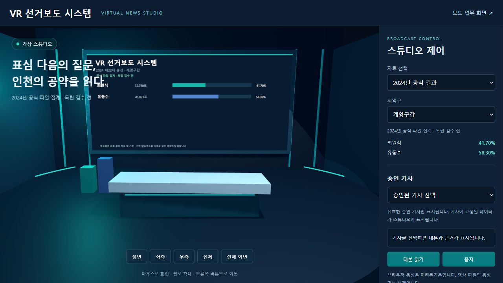

# VR 선거보도 시스템 구현 결과

검증일: **2026-11-24**. 대상은 이 저장소에 통합한 코드입니다. 가상 후보·가상 공약·가상 수치를 이용해 기능을 검증했으며 실제 사람의 편집 승인·실제 후보 공약 비교 보도가 완료됐다는 뜻은 아닙니다.

## 실제 구현

| 영역 | 구현과 확인 결과 |
| --- | --- |
| 두 서버 | FastAPI 송신 서버와 보도 서버를 실제 TCP 포트에서 실행 |
| 실시간 갱신 | 이력 조회·WebSocket 새 이벤트 수신·중복 해시 확인·장애 표시와 시뮬레이션 전환 |
| 근거 검색 | 선거·지역·후보·자료 유형을 제한한 문단 키워드 검색과 근거 ID |
| 기사 초안 | 고정 스냅샷과 문서 청크로 정형 문장 생성, 수정본 새 ID |
| 팩트체크 | 수치·후보·지역·시각·출처·문장 변조·근거 누락/철회 검사 |
| 독립 승인 | writer/editor 권한 분리, 자기 승인 금지, 원문 확인·AI 미연결 확인·사유 필요 |
| 내보내기 | APPROVED 상태를 재검증한 JSON, 문장·근거·스냅샷 고정 |
| 화면 | 메뉴 이동·시각/출처·검색·기사 검증·승인, 결측값 미제공 표시 |
| 승인 화면 제어 | 기사·토큰 변경 시 확인 초기화, 수동 확인·사유 전 버튼 비활성 |
| DB | CREATE TABLE 7개, INSERT 예제, 조회 SQL, 기존 자료가 있는 DB의 예제 재입력 거부 |

PC 중심 v2에서는 실제 Three.js 가상 스튜디오, 공식 원본 행 대조, 자료별 독립 검수, PDF 보존·본문 추출, 기사 수정, 감사 무결성·백업, 승인 기사 기반 FHD MP4·자막·CG·ZIP 제작을 추가했습니다. [v2 사용 안내](platform-guide.md)를 기준으로 실행합니다.

## 실행한 시험

| 시험 | 통과 | 증빙 |
| --- | --- | --- |
| 단위 및 SQL 및 화면 빌드 | **56/56** | [unit_results.xml](../outputs/unit_results.xml) |
| 실제 서버 통합 | **13/13** | [integration_results.json](../outputs/integration_results.json) |
| PC 스튜디오·영상·자료 검수 통합 | **24/24** | [platform_integration_results.json](../outputs/platform_integration_results.json) |
| 화면 승인 제어 로직 | **8/8** | [ui_logic_results.json](../outputs/ui_logic_results.json) |

통합 시험은 정상 기사 생성·검증·시험 editor 승인·내보내기와 지역 오류 주입 후 승인/내보내기 409 차단, 토큰 없는 요청 401, writer 승인 시도 403, 송신 중단 후 오류와 대체 자료 표시를 재현했습니다. `TEST-*` 계정의 자동 승인은 실제 편집 승인으로 제출하지 않습니다.

화면 로직 시험은 실제 HTML의 JavaScript를 Node VM과 DOM 대역에서 실행했습니다. 별도로 실제 브라우저에서 1448×1086 PC와 390×844 모바일 배치, 지역·후보 변경과 근거 갱신, 초안 생성·규칙 검증, 승인/내보내기 비활성, 공식 자료실 열기를 확인했습니다. 두 화면 모두 문서 전체의 가로 넘침이 없었고, 모바일 수치 표는 내부 스크롤을 사용합니다. [PC 캡처](../outputs/screenshots/dashboard-desktop.jpg)와 [모바일 캡처](../outputs/screenshots/dashboard-mobile.jpg)는 실제 실행 화면이며 디자인 PNG와 구분합니다. 접근성 인증이나 모든 브라우저 호환성을 보장하는 시험은 아닙니다.

SQL 스크립트로 만든 예제 DB는 snapshot 1건·chunk 6건·article 1건·approval 0건·audit 8건입니다. 예제 기사는 실제 검증 로직에서 PENDING_HUMAN이 되지만 승인 전 내보내기는 거부됩니다. 외래키와 감사 해시 연결, 감사 기록 수정 거부도 확인했습니다.

실제 브라우저에서 PC 3D 렌더링·카메라 이동, 문서 등록·기사 생성·역할 전환·TEST 승인·5초 FHD 영상 제작을 확인했습니다. 390×844 모바일에서도 페이지 가로 넘침이 없었습니다. 영상은 승인 기사로 구성한 2D CG이며 3D 장면 녹화와 구분합니다. [영상 시험 산출물](../outputs/production_sample/README.txt)은 실제 편집 승인 보도가 아닌 자동 시험 결과입니다.

## 보존 자료와 미완료 범위

- 최신 문서 7종과 디자인 PNG 2종을 함께 보존했습니다. 화면설계서는 디자인 이미지가 포함된 5쪽 버전입니다.
- 공식 원본·원장·인천 정제본을 보존했습니다. 실제 집계 독립 대조와 실제 후보 공약 본문 확보·검수는 남아 있습니다.
- 2026-11-20 보고서·PPT·20분 검토 영상·대본·자막·옛 시험 기록은 [archive](../outputs/archive/20261120)에 보존했습니다. 이전 자료의 상태·용어를 최신 검수 완료 기록으로 간주하지 않습니다.
- 현재 외부 생성형 AI·벡터 DB·HMD·WebXR 연동, 외부 공개 운영, 실제 사람의 기사 최종 승인과 사실 보도 영상 확정은 미완료입니다.

## 재현과 변경 기록

[README](../README.md)의 실행/시험 절차와 [DB 안내](../db/README.md)를 따릅니다. [Git 커밋 기록](https://github.com/mbc-incheon/VR-Election-News/commits/main/)과 [협업 절차](collaboration.md)에서 버전과 검토 기준을 확인합니다. 실제 PR·역할 담당자·승인자 기록이 없는 부분은 임의 작성하지 않습니다.

초기 통합본은 `election-analysis-project-01`에서 검증해 이관했습니다. 위 결과는 첨부 디자인을 실제 화면에 적용한 `VR-Election-News` 변경본에서 갱신했습니다. 자동 시험 상태는 Actions에서 확인합니다.

관리자 로그인·로그아웃, 담당자 발급·중복 방지, 인증 실패 제한, 세션 폐기, 관리자 기사 작성 차단, 기존 계정을 보존하는 관리자 추가를 자동 검증했습니다. 실제 브라우저에서 업무 화면의 관리자 메뉴 연결과 로그인 화면 표시를 확인했습니다. [관리자 화면 캡처](../outputs/screenshots/admin-login.jpg).
